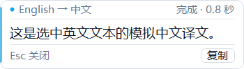
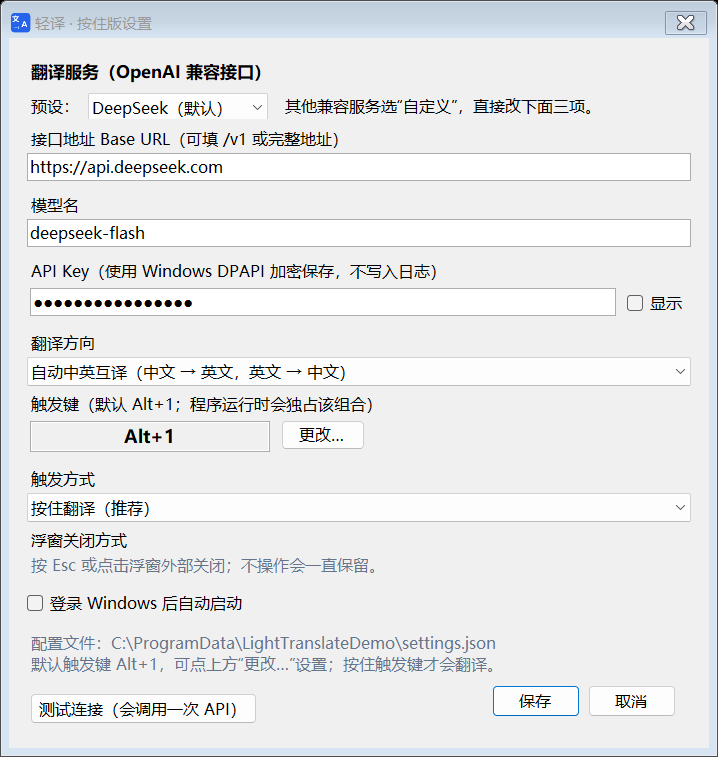

# 轻译 · 按住版（LightTranslateHold）
 
 > GitHub 仓库：<https://github.com/greatZhaoFD/LightTranslateHold>

Windows 上的轻量划词翻译小工具：**选中文字，按下快捷键，译文出现在选中区域下方**。中英双向，调用你自己的 OpenAI 兼容大模型 API，托盘后台常驻。

> 本项目基于 MIT 开源的 [LightTranslate / 轻译 v1.0.0](https://github.com/shanghaiyangming/lighttranslate) 改造，增加了按住式组合键、中英双向、选区下方无焦点浮窗、设置界面等能力。不是上游官方发布，问题请反馈到本项目。





## 来源与改造说明

本项目**不是从零开发**，而是基于开源项目 **轻译 / LightTranslate** 改造：

- 上游仓库：<https://github.com/shanghaiyangming/lighttranslate>
- 上游版本：v1.0.0（MIT License，Copyright © 2026 shanghaiyangming）
- 上游许可证：见 `src/LICENSE-LightTranslate.txt`
- 本项目与上游作者无隶属关系，不是上游官方发布。

在上游基础上主要做了这些改造：

- 把“按一下快捷键”改为 **按住/按下 `Alt+1` 触发**，并支持在设置里重新捕获组合键。
- 将“只译成中文”改为 **中英双向**（自动判断，也可固定目标语言）。
- 独立实现无焦点译文浮窗，优先定位到选区下方，支持流式输出、复制、长文滚动。
- 增加 **Esc / 点击浮窗外关闭**（全局鼠标钩子），取消自动消失。
- 移除上游的输入框/词典/OCR 等重功能，改为轻量单文件托盘工具。
- 增加阿里云百炼等预设，并保留 Base URL / 模型名 / API Key 自定义。

## 功能

- **按键才翻译**：先选中文字，再按下 `Alt+1` 即触发；不按不会翻译。松开后浮窗不会自动消失，按 `Esc` 或点击浮窗外关闭。
- **中英双向**：自动判断中文→英文 / 英文→中文；也可固定译成中文或英文。
- **大模型 API**：支持任意 OpenAI 兼容接口，默认 DeepSeek；可填 Base URL、模型名、API Key。
- **选区下方浮窗**：优先用 UI Automation 获取选区矩形，失败时回退到光标/鼠标位置；浮窗置顶、无焦点、不抢当前应用焦点。
- **流式输出**：边生成边显示；支持 Markdown 常用格式的纯文本显示、复制、Esc 关闭、长文滚动。
- **托盘常驻**：设置、重新加载配置、翻译剪贴板、复制上次译文、开机启动、退出。
- **本地安全**：API Key 使用 Windows DPAPI 当前用户加密保存；不保存翻译历史；无遥测/中转服务器。
- **轻量**：单 exe（约 120 KB），仅依赖 Windows 自带的 .NET Framework 4.8；不使用 Electron/WebView2。

## 快速开始

### 运行环境

- Windows 10 / 11 x64
- .NET Framework 4.8（Windows 10/11 通常已自带；没有会提示安装）
- 能访问你配置的 API 端点

### 第一次使用

1. **首次启动**（还没有配置文件）：双击 `LightTranslateHold.exe` 会自动打开设置窗口。填写 API Key 并保存。
2. 以后再启动：程序静默进入右下角托盘，不弹设置窗口；需要改配置时右键托盘 → 设置…（或双击托盘图标）。
3. 默认预设是 **DeepSeek**：
   - 接口：`https://api.deepseek.com`
   - 模型：`deepseek-flash`
   - API Key：在 [DeepSeek 平台](https://platform.deepseek.com/api_keys) 创建后填入
   - 填好后点“测试连接（会调用一次 API）”确认。
4. 保存后停留在托盘后台。
5. 在任意支持复制的应用里选中文字，**按下 `Alt+1`**（按住或轻按都行）；译文会出现在选区/光标下方。松开后浮窗一直保留。
6. 按 `Esc` 或点击浮窗外部关闭；浮窗右下角“复制”可复制译文。

> 如果 `Alt+1` 与当前软件冲突，或者按 Alt 会弹出菜单：打开托盘 → 设置 → 触发键 → **更改…**，按下新的组合键（例如 `Ctrl+Alt+Q`、`F8`）。字母/数字单键不允许，避免影响正常输入。

### 启动与托盘

- **首次启动**（没有配置文件）：双击 EXE 自动打开设置窗口，方便填写 API Key。
- **之后启动**：静默进入右下角托盘，不弹主窗口；右键托盘图标或双击图标打开设置。
- **开机自启**：始终静默进托盘，不弹窗。
- 托盘气泡会提示“轻译已在后台运行”；未配置 Key 时托盘提示“未配置 API Key”。

### 托盘菜单

- 翻译剪贴板：不用划词，直接翻译当前剪贴板文字（方便测试 API）。
- 复制上次译文。
- 设置… / 重新加载配置。
- 开机自动启动（写入当前用户注册表 Run）。
- 打开数据目录（配置和日志）。
- 退出。

## 快捷键与交互

| 操作 | 默认行为 |
| --- | --- |
| 按下 `Alt+1` | 读取当前选中文字并翻译；不按不会触发 |
| 松开 | 浮窗保持，不会自动消失 |
| 触发后 | 浮窗保持显示，不抢焦点 |
| `Esc` | 关闭浮窗并取消进行中的请求 |
| 再次按下 | 取消上一次并翻译新选区 |
| 点击浮窗“复制” | 复制完整译文（不关闭浮窗） |

设置里还可以选择“按一下翻译”，适合不习惯按住的场景；无论哪种方式，关闭都只靠 `Esc` 或点击浮窗外。

切换到百炼等其它服务：托盘 → 设置 → 预设选“阿里云百炼（DashScope）”，填入百炼 API Key；也可选“自定义”，直接填写 Base URL、模型名和 Key。所有 OpenAI Chat Completions 兼容接口都可以用。

## API 配置

程序使用标准 **OpenAI Chat Completions** 接口：

- Base URL 可以填到 `/v1`，也可以直接填完整的 `/chat/completions` 地址。
- 非本机地址必须用 HTTPS；HTTP 只允许 `127.0.0.1` / `localhost`（保护 API Key）。
- 默认对 `api.deepseek.com` 自动附加 `thinking: {type: "disabled"}`；其它兼容接口不会收到这个参数，避免 400。

常见配置：

| 服务 | Base URL | 模型示例 |
| --- | --- | --- |
| DeepSeek（默认） | `https://api.deepseek.com` | `deepseek-flash` |
| 阿里云百炼（DashScope） | `https://dashscope.aliyuncs.com/compatible-mode/v1` | `qwen-plus`（可改） |
| OpenAI | `https://api.openai.com/v1` | `gpt-4.1-mini` 或你的可用模型 |
| 本地 Ollama | `http://127.0.0.1:11434/v1` | `qwen2.5:7b` 等本地模型 |
| 自定义/其它兼容服务 | 服务商给出的 `/v1` 地址 | 手动填写 |
| 其它兼容服务 | 服务商给出的 `/v1` 地址 | 以其文档为准 |

API Key 只在当前 Windows 用户下可解密，配置保存在：

```
%APPDATA%\LightTranslateHold\settings.json
```

日志（只记录错误和少量运行信息）：

```
%APPDATA%\LightTranslateHold\logs\
```

## 构建

只依赖 Windows 自带的 .NET Framework 4.8 编译器（`csc.exe`），不需要 VS / NuGet：

```powershell
cd lighttranslate
powershell -NoProfile -ExecutionPolicy Bypass -File .\build.ps1 -Test
```

产物：项目根目录的 `LightTranslateHold.exe`，双击即可运行。

`-Test` 会额外编译一个控制台测试程序并运行核心自测（DPAPI、热键解析、方向判断、URL 校验、SSE 解析、本地 mock API 端到端、401 错误映射）。

### 目录

```
LightTranslateHold.exe  可直接运行的成品（双击启动）
使用说明.txt            简短使用说明
README.md               本文件
LICENSE                 本项目 MIT 许可证
src/
  Program.cs          入口、托盘、按键触发逻辑、设置应用
  Settings.cs         配置/路径/DPAPI/日志
  Hotkey.cs           组合键解析、格式化和按键捕获窗口
  KeyboardHook.cs     全局低级键盘钩子
  MouseHook.cs        全局鼠标钩子（点击浮窗外关闭）
  Selection.cs        UI Automation 取词与选区定位，剪贴板回退
  Translator.cs       中英方向、Prompt、OpenAI 兼容 SSE 客户端
  PopupForm.cs        无焦点译文浮窗
  SettingsForm.cs     设置窗口
  Native.cs           Win32 互操作
  SelfTest.cs         核心自测 + mock API
  DemoMode.cs         截图演示模式（开发用）
  ConsoleTest.cs      控制台测试入口（开发用）
  app.manifest        高 DPI 清单
  assets/             图标
docs/                 截图、测试记录
build.ps1             构建/测试脚本
```

## 测试状态

- 核心自测：**22 项全部通过**（见 `docs/测试记录.md`）。
- 本地 mock API 端到端：按下 `Alt+1` → 读取选区(模拟) → 流式请求 → 浮窗显示 → 截图，已通过。
- 浮窗验证：可见时 `WS_EX_NOACTIVATE/WS_EX_TOOLWINDOW/WS_EX_TOPMOST`；无操作 8 秒后仍然可见，不会自动消失。
- **真实选中文字抓取**：实际运行日志已出现 UI Automation 成功取词（38/88 字符）并完成翻译；剪贴板回退路径在部分受限应用中的兼容性需按实际场景验证。
- **真实 API**：本机已用兼容接口成功返回译文；DeepSeek、百炼、OpenAI 等服务请用自己的 Key 点“测试连接”验证。

详细记录：`docs/测试记录.md`。

## 已知限制

- 只能翻译“可复制”的选中文本；图片/扫描 PDF 不支持（无 OCR）。
- 部分应用（管理员权限窗口、某些终端/PDF/游戏）禁止模拟 `Ctrl+C`，会提示读取失败；可尝试“翻译剪贴板”。
- 剪贴板恢复仅覆盖文字、富文本、HTML、CSV 和文件列表，不备份大图片/音频，避免内存和耗时；若剪贴板在这期间被其他程序改写，则不会强行恢复。
- `Alt+1` 是系统级组合键；个别程序仍可能响应 Alt 菜单或占用该组合，可在设置中换成 `Ctrl+Alt+Q` / `F8` 等。
- 浮窗无焦点，鼠标滚轮滚动依赖 Windows 的“悬停非活动窗口时滚动”设置（默认开启）；长文也可以先点“复制”再粘贴查看。
- 程序未做商业代码签名，Windows SmartScreen 可能提示“未知发布者”。请从本项目目录/可信来源获取，或自行用源码构建。
- 便携版移动了 EXE 路径后，需要在设置里重新开关“开机自动启动”。
- API 费用由服务商按你的用量收取；程序本身免费。

## 隐私

- 原文和提示词只发送到**你自己配置的 API 端点**，项目没有中转服务器。
- 不保存翻译历史；进程内最多保留最后一次译文用于“复制上次译文”。
- API Key 使用 Windows DPAPI 当前用户加密；日志不记录 Key 或原文。
- 不收集遥测。

## 许可与致谢

- 本项目代码：MIT License（见 `LICENSE`）。
- 改造自 [shanghaiyangming/lighttranslate](https://github.com/shanghaiyangming/lighttranslate) v1.0.0，Copyright © 2026 shanghaiyangming，MIT License；原始许可证见 `src/LICENSE-LightTranslate.txt`。
- 图标来自上游 MIT 项目。
- 使用 [.NET Framework](https://dotnet.microsoft.com/) / Windows Forms / Win32 / UI Automation 构建。
